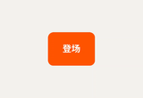
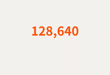
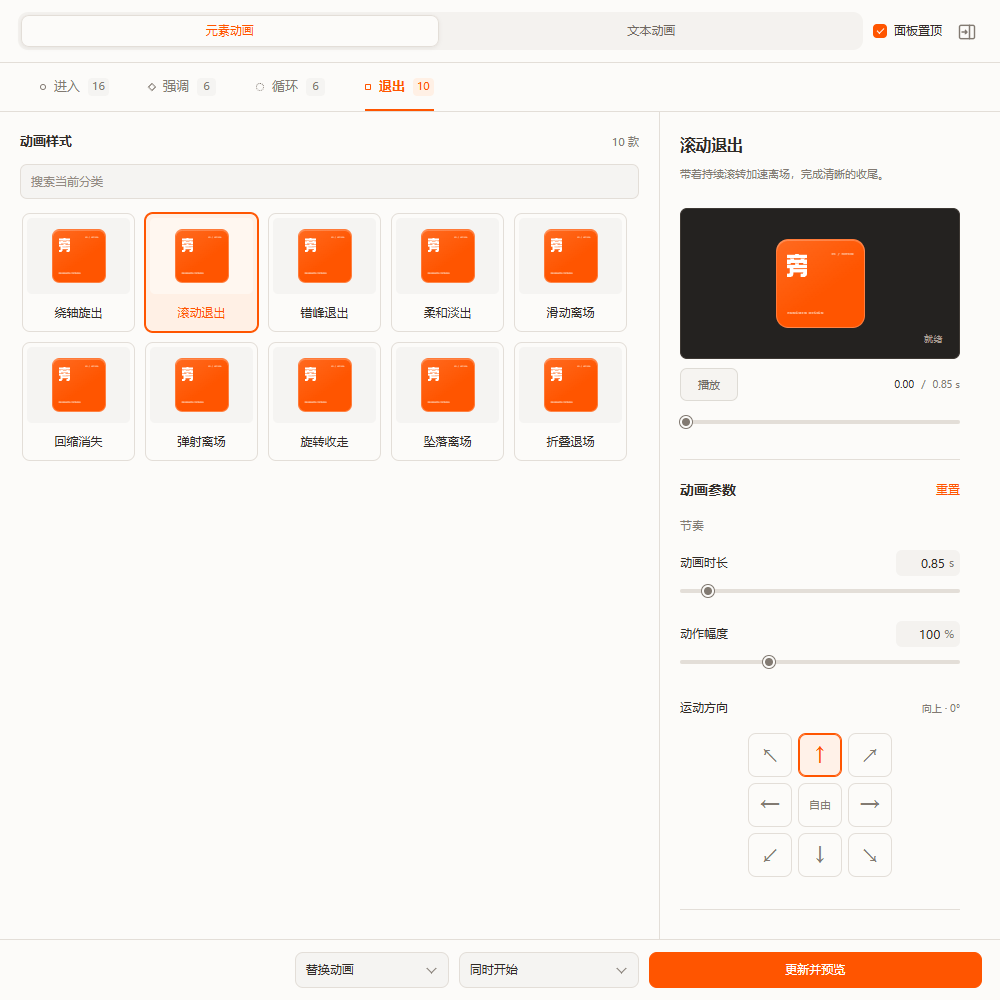
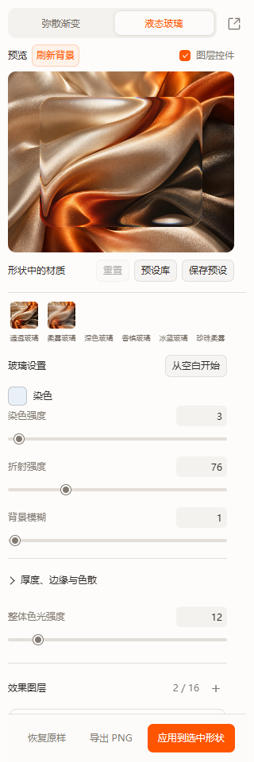

<p align="center"></p>
<h1 align="center">旁门工具箱</h1>
<p align="center"><strong>在 PowerPoint 里，为内容加上动画与材质。</strong></p>
<p align="center">形状效果 · 元素与文本动画 · 图片型 PDF 导出</p>
<p align="center">
<a href="https://github.com/sxx297/pangmen-toolbox/releases/latest"><strong>下载安装包</strong></a> ·
<a href="#动画画廊">动画画廊</a> ·
<a href="#形状画廊">形状画廊</a> ·
<a href="docs/USER_GUIDE.md">使用指南</a> ·
<a href="https://github.com/sxx297/pangmen-toolbox/issues">反馈问题</a>
</p>
<p align="center"><sub>Windows 桌面版 PowerPoint · v1.0.11 · GPL-3.0-only 开源</sub></p>

---

## 先看效果

<table>
<tr>
<td width="25%" align="center"><a href="docs/media/gallery/anvil.gif"></a><br><strong>轰然坠落</strong><br><sub>急速坠落<br>落点尘雾扩散</sub></td>
<td width="25%" align="center"><a href="docs/media/gallery/number-roll.gif"></a><br><strong>数值滚动</strong><br><sub>逐位滚动<br>停在原数值</sub></td>
<td width="25%" align="center"><a href="docs/media/gallery/material-spectrumFrame.png"></a><br><strong>弥散渐变</strong><br><sub>多层色光<br>丰富卡片层次</sub></td>
<td width="25%" align="center"><a href="docs/media/gallery/material-glass.png"></a><br><strong>液态玻璃</strong><br><sub>背景折射<br>柔和边缘高光</sub></td>
</tr>
</table>

**如何制作：** 选中 PPT 对象，在动画库选择效果；或在形状效果中选择预设，调整参数后应用。[完整使用步骤 →](docs/USER_GUIDE.md)

## 能做什么

| 模块 | 主要能力 | 常见用途 |
| --- | --- | --- |
| **动画库** | 38 款元素动画 + 13 款文本动画；进入、强调、循环、退出；预览与参数调整 | 产品登场、标题节奏、数据展示、重点强调 |
| **形状效果** | 弥散渐变、液态玻璃、多层色光、预设保存、导出 PNG、恢复原样 | 卡片、封面、信息叠层、装饰形状 |
| **PDF 导出** | 选择页面与输出质量，输出图片型 PDF | 固定版式交付、分享演示内容 |
| **面板布局** | 侧栏与悬浮窗；统一控件、图层操作与提示 | 边做边调，按屏幕空间选择布局 |

数量依据 **v1.0.11 正式开放目录**，不包含待实现和已移除效果。[查看完整动画清单与参数说明 →](docs/USER_GUIDE.md#动画库)

<details>
<summary><strong>展开查看编辑器界面</strong></summary>

以下为同源页面的独立预览界面，便于了解布局；上方案例展示的是 PowerPoint 导出效果。

<p align="center"></p>
<p align="center"></p>

</details>

## 动画画廊

**51 款正式动画 · 38 款元素动画 + 13 款文本动画**

展开分类查看全部动图，点击缩略图可放大。所有动画均由插件原生逻辑在真实 PowerPoint 中执行、导出，案例字体为思源黑体。

GIF 循环仅用于展示；进入、强调和退出效果保留短暂停顿，循环效果展示一个周期。实际效果仍由 PPT 中的播放设置控制。

### 元素动画

<details>
<summary><strong>进入 · 16 款</strong></summary>

<table>
<tr>
<td width="33%" align="center"><a href="docs/media/gallery/alternate-in.gif"></a><br><strong>交错入场</strong></td>
<td width="33%" align="center"><a href="docs/media/gallery/pivot-in.gif"></a><br><strong>绕轴旋入</strong></td>
<td width="33%" align="center"><a href="docs/media/gallery/jack-in.gif"></a><br><strong>俏皮弹入</strong></td>
</tr>
<tr>
<td width="33%" align="center"><a href="docs/media/gallery/roll-in.gif"></a><br><strong>滚动进入</strong></td>
<td width="33%" align="center"><a href="docs/media/gallery/grid-in.gif"></a><br><strong>错峰进入</strong></td>
<td width="33%" align="center"><a href="docs/media/gallery/anvil.gif"></a><br><strong>轰然坠落</strong></td>
</tr>
<tr>
<td width="33%" align="center"><a href="docs/media/gallery/spring.gif"></a><br><strong>弹性弹入</strong></td>
<td width="33%" align="center"><a href="docs/media/gallery/float-in.gif"></a><br><strong>柔和上浮</strong></td>
<td width="33%" align="center"><a href="docs/media/gallery/bounce-in.gif"></a><br><strong>弹跳落地</strong></td>
</tr>
<tr>
<td width="33%" align="center"><a href="docs/media/gallery/brake-in.gif"></a><br><strong>滑行刹停</strong></td>
<td width="33%" align="center"><a href="docs/media/gallery/zoom-in.gif"></a><br><strong>缩放登场</strong></td>
<td width="33%" align="center"><a href="docs/media/gallery/impact-in.gif"></a><br><strong>放大冲入</strong></td>
</tr>
<tr>
<td width="33%" align="center"><a href="docs/media/gallery/flip-in.gif"></a><br><strong>翻转入场</strong></td>
<td width="33%" align="center"><a href="docs/media/gallery/rotate-in.gif"></a><br><strong>旋转落位</strong></td>
<td width="33%" align="center"><a href="docs/media/gallery/fold-in.gif"></a><br><strong>折叠展开</strong></td>
</tr>
<tr>
<td width="33%" align="center"><a href="docs/media/gallery/fade-in.gif"></a><br><strong>柔和淡入</strong></td>
<td width="33%"></td>
<td width="33%"></td>
</tr>
</table>

</details>

<details>
<summary><strong>强调 · 6 款</strong></summary>

<table>
<tr>
<td width="33%" align="center"><a href="docs/media/gallery/flip-once.gif"></a><br><strong>翻转一次</strong></td>
<td width="33%" align="center"><a href="docs/media/gallery/hop.gif"></a><br><strong>轻弹一下</strong></td>
<td width="33%" align="center"><a href="docs/media/gallery/jelly.gif"></a><br><strong>果冻弹动</strong></td>
</tr>
<tr>
<td width="33%" align="center"><a href="docs/media/gallery/wobble.gif"></a><br><strong>摇摆提示</strong></td>
<td width="33%" align="center"><a href="docs/media/gallery/shake.gif"></a><br><strong>震动提醒</strong></td>
<td width="33%" align="center"><a href="docs/media/gallery/focus.gif"></a><br><strong>聚焦放大</strong></td>
</tr>
</table>

</details>

<details>
<summary><strong>循环 · 6 款</strong></summary>

<table>
<tr>
<td width="33%" align="center"><a href="docs/media/gallery/orbit.gif"></a><br><strong>轨道浮游</strong></td>
<td width="33%" align="center"><a href="docs/media/gallery/hover.gif"></a><br><strong>轻盈悬浮</strong></td>
<td width="33%" align="center"><a href="docs/media/gallery/breathe.gif"></a><br><strong>呼吸缩放</strong></td>
</tr>
<tr>
<td width="33%" align="center"><a href="docs/media/gallery/pendulum.gif"></a><br><strong>往返摇动</strong></td>
<td width="33%" align="center"><a href="docs/media/gallery/spin.gif"></a><br><strong>匀速旋转</strong></td>
<td width="33%" align="center"><a href="docs/media/gallery/heartbeat.gif"></a><br><strong>心跳脉冲</strong></td>
</tr>
</table>

</details>

<details>
<summary><strong>退出 · 10 款</strong></summary>

<table>
<tr>
<td width="33%" align="center"><a href="docs/media/gallery/pivot-out.gif"></a><br><strong>绕轴旋出</strong></td>
<td width="33%" align="center"><a href="docs/media/gallery/roll-out.gif"></a><br><strong>滚动退出</strong></td>
<td width="33%" align="center"><a href="docs/media/gallery/grid-out.gif"></a><br><strong>错峰退出</strong></td>
</tr>
<tr>
<td width="33%" align="center"><a href="docs/media/gallery/fade-out.gif"></a><br><strong>柔和淡出</strong></td>
<td width="33%" align="center"><a href="docs/media/gallery/slide-out.gif"></a><br><strong>滑动离场</strong></td>
<td width="33%" align="center"><a href="docs/media/gallery/shrink-out.gif"></a><br><strong>回缩消失</strong></td>
</tr>
<tr>
<td width="33%" align="center"><a href="docs/media/gallery/launch-out.gif"></a><br><strong>弹射离场</strong></td>
<td width="33%" align="center"><a href="docs/media/gallery/rotate-out.gif"></a><br><strong>旋转收走</strong></td>
<td width="33%" align="center"><a href="docs/media/gallery/fall-out.gif"></a><br><strong>坠落离场</strong></td>
</tr>
<tr>
<td width="33%" align="center"><a href="docs/media/gallery/fold-out.gif"></a><br><strong>折叠退场</strong></td>
<td width="33%"></td>
<td width="33%"></td>
</tr>
</table>

</details>

### 文本动画

<details>
<summary><strong>进入 · 7 款</strong></summary>

<table>
<tr>
<td width="33%" align="center"><a href="docs/media/gallery/number-count.gif"></a><br><strong>数值变动</strong></td>
<td width="33%" align="center"><a href="docs/media/gallery/number-roll.gif"></a><br><strong>数值滚动</strong></td>
<td width="33%" align="center"><a href="docs/media/gallery/typewriter.gif"></a><br><strong>逐字出现</strong></td>
</tr>
<tr>
<td width="33%" align="center"><a href="docs/media/gallery/text-spring.gif"></a><br><strong>逐字弹入</strong></td>
<td width="33%" align="center"><a href="docs/media/gallery/text-float.gif"></a><br><strong>逐字上浮</strong></td>
<td width="33%" align="center"><a href="docs/media/gallery/text-flip.gif"></a><br><strong>字符翻入</strong></td>
</tr>
<tr>
<td width="33%" align="center"><a href="docs/media/gallery/text-tracking.gif"></a><br><strong>字距收拢</strong></td>
<td width="33%"></td>
<td width="33%"></td>
</tr>
</table>

</details>

<details>
<summary><strong>强调 · 2 款</strong></summary>

<table>
<tr>
<td width="33%" align="center"><a href="docs/media/gallery/text-wave-once.gif"></a><br><strong>逐字强调波</strong></td>
<td width="33%" align="center"><a href="docs/media/gallery/text-highlight.gif"></a><br><strong>荧光标记</strong></td>
<td width="33%"></td>
</tr>
</table>

</details>

<details>
<summary><strong>循环 · 1 款</strong></summary>

<table>
<tr>
<td width="33%" align="center"><a href="docs/media/gallery/text-breathe.gif"></a><br><strong>呼吸文字</strong></td>
<td width="33%"></td>
<td width="33%"></td>
</tr>
</table>

</details>

<details>
<summary><strong>退出 · 3 款</strong></summary>

<table>
<tr>
<td width="33%" align="center"><a href="docs/media/gallery/text-fade-out.gif"></a><br><strong>逐字淡出</strong></td>
<td width="33%" align="center"><a href="docs/media/gallery/text-sink.gif"></a><br><strong>逐字下沉</strong></td>
<td width="33%" align="center"><a href="docs/media/gallery/text-scatter.gif"></a><br><strong>向外飞散</strong></td>
</tr>
</table>

</details>

## 形状画廊

**28 个内置预设 · 16 个弥散渐变 + 12 个液态玻璃**

以下图片使用插件实际材质渲染器生成。玻璃统一使用预设库内置的绸缎背景，便于比较折射、模糊与边缘高光。光球、透镜保留圆形轮廓，其他预设使用圆角矩形。

### 弥散渐变

<table>
<tr>
<td width="33%" align="center"><a href="docs/media/gallery/material-blue.png"></a><br><strong>冰蓝弥散</strong></td>
<td width="33%" align="center"><a href="docs/media/gallery/material-purple.png"></a><br><strong>紫色辉光</strong></td>
<td width="33%" align="center"><a href="docs/media/gallery/material-aurora.png"></a><br><strong>极光混色</strong></td>
</tr>
<tr>
<td width="33%" align="center"><a href="docs/media/gallery/material-amber.png"></a><br><strong>琥珀暖光</strong></td>
<td width="33%" align="center"><a href="docs/media/gallery/material-rose.png"></a><br><strong>玫瑰霞光</strong></td>
<td width="33%" align="center"><a href="docs/media/gallery/material-jade.png"></a><br><strong>翡翠流光</strong></td>
</tr>
<tr>
<td width="33%" align="center"><a href="docs/media/gallery/material-violetOrb.png"></a><br><strong>紫晶光球</strong></td>
<td width="33%" align="center"><a href="docs/media/gallery/material-azureOrb.png"></a><br><strong>冰蓝光球</strong></td>
<td width="33%" align="center"><a href="docs/media/gallery/material-spectrumFrame.png"></a><br><strong>幻彩霓虹</strong></td>
</tr>
<tr>
<td width="33%" align="center"><a href="docs/media/gallery/material-violetFrame.png"></a><br><strong>蓝紫光框</strong></td>
<td width="33%" align="center"><a href="docs/media/gallery/material-cyanTrace.png"></a><br><strong>青瓷微光</strong></td>
<td width="33%" align="center"><a href="docs/media/gallery/material-auroraCrown.png"></a><br><strong>极光顶光</strong></td>
</tr>
<tr>
<td width="33%" align="center"><a href="docs/media/gallery/material-gilded.png"></a><br><strong>鎏金磨砂</strong></td>
<td width="33%" align="center"><a href="docs/media/gallery/material-silver.png"></a><br><strong>冷银磨砂</strong></td>
<td width="33%" align="center"><a href="docs/media/gallery/material-roseCopper.png"></a><br><strong>玫瑰铜光</strong></td>
</tr>
<tr>
<td width="33%" align="center"><a href="docs/media/gallery/material-redCopper.png"></a><br><strong>赤铜暖光</strong></td>
<td width="33%"></td>
<td width="33%"></td>
</tr>
</table>

### 液态玻璃

<table>
<tr>
<td width="33%" align="center"><a href="docs/media/gallery/material-glass.png"></a><br><strong>通透玻璃</strong></td>
<td width="33%" align="center"><a href="docs/media/gallery/material-frosted.png"></a><br><strong>柔雾玻璃</strong></td>
<td width="33%" align="center"><a href="docs/media/gallery/material-smoked.png"></a><br><strong>深色玻璃</strong></td>
</tr>
<tr>
<td width="33%" align="center"><a href="docs/media/gallery/material-champagne.png"></a><br><strong>香槟玻璃</strong></td>
<td width="33%" align="center"><a href="docs/media/gallery/material-ice.png"></a><br><strong>冰蓝玻璃</strong></td>
<td width="33%" align="center"><a href="docs/media/gallery/material-pearl.png"></a><br><strong>珍珠柔雾</strong></td>
</tr>
<tr>
<td width="33%" align="center"><a href="docs/media/gallery/material-crystalLens.png"></a><br><strong>水晶透镜</strong></td>
<td width="33%" align="center"><a href="docs/media/gallery/material-mistLens.png"></a><br><strong>雾面透镜</strong></td>
<td width="33%" align="center"><a href="docs/media/gallery/material-sandPane.png"></a><br><strong>暖砂薄玻璃</strong></td>
</tr>
<tr>
<td width="33%" align="center"><a href="docs/media/gallery/material-cloudPane.png"></a><br><strong>云蓝玻璃</strong></td>
<td width="33%" align="center"><a href="docs/media/gallery/material-milkPane.png"></a><br><strong>乳白磨砂</strong></td>
<td width="33%" align="center"><a href="docs/media/gallery/material-midnightPane.png"></a><br><strong>深蓝柔光玻璃</strong></td>
</tr>
</table>

## 安装与上手

### 1. 下载并安装

从 [最新 Release](https://github.com/sxx297/pangmen-toolbox/releases/latest) 下载 **PangmenToolbox-1.0.11-Windows.zip**，解压后运行其中的安装程序。压缩包包含安装器、许可证、第三方声明与安装说明；Release 同时提供独立 EXE 和 SHA256 校验文件。

1. 保存文稿并关闭 PowerPoint。
2. 运行 `PangmenToolbox-Setup-1.0.11.exe`，按提示安装。
3. 重新打开 PowerPoint，在“旁门工具箱”选项卡启动功能。

**环境要求：** Windows 桌面版 Microsoft PowerPoint、.NET Framework 4.8、Microsoft Edge WebView2 Runtime。安装器自动检测 Office 位数；当前主要实测环境为 **64 位 Office**。

### 2. 应用到自己的内容

- **动画：** 选中对象，选择卡片，调整有效参数；按需要选择“替换动画 / 保留动画”和“单击时 / 同时开始 / 之后开始”。使用底栏按钮在 PowerPoint 中预览，修改后可更新。
- **形状：** 选中支持的形状，打开形状效果，选择预设并微调，点击“应用到选中形状”。想撤回材质时使用“恢复原样”。
- **导出：** 打开 PDF 导出，选择页面和质量，然后保存输出。

完整步骤、数字动画限制与常见问题见 [使用指南](docs/USER_GUIDE.md)。

## 使用前了解

- **数字动画**：一个文本框内只包含一个数值；绝对值不超过 **999,999,999**，小数最多 **6 位**，符号与单位合计最多 **40 个字符**。还需满足单行、统一字体格式、字号不超过 180 磅、无旋转/填充/边框等条件。
- **材质效果**：使用渲染图像表现，不是 PowerPoint 原生的实时玻璃着色器；部分旋转、翻转、组合及导入对象受限制。
- **PDF**：为图片型输出，文字不可搜索或作为文本选择。
- **兼容性**：不支持 macOS、网页版 PowerPoint；未验证所有历史 Office 版本及 32 位 Office 功能组合。
- **签名状态**：安装包当前没有发布者 Authenticode 签名。不要为安装关闭系统防护或绕过组织策略。

遇到安装问题，可使用开始菜单的修复/诊断入口。[反馈问题](https://github.com/sxx297/pangmen-toolbox/issues) 时注明版本、系统及 Office 位数，公开诊断前删除个人路径和客户信息。

## 开发与贡献

在 Windows 中准备 Python 3.10+、Node.js 20+ 与 Windows PowerShell 5.1：

```powershell
npm ci
python tools/bootstrap-build.py
python tools/build-toolbox.py
```

输出位于 `dist/`。源码构建会生成独立开发强名称密钥，正式私钥不随仓库发布。请在测试环境验证自行构建的安装包。

<details>
<summary>浏览器预览与目录结构</summary>

```powershell
python tools/build-theme.py
python features/shapes/prototype/build-preview.py
python features/animations/build-preview.py
python tools/preview.py
```

打开 <http://127.0.0.1:8780>，使用示例内容，不读写 PPT。

| 目录 | 内容 |
| --- | --- |
| `host/` | COM 加载项、Ribbon、任务面板、窗口管理 |
| `features/` | 形状、动画、PDF 功能实现 |
| `shared/ui/` | 公共主题与组件 |
| `installer/` | 安装、修复、卸载、诊断 |
| `tools/`、`tests/` | 构建与回归检查 |
| `examples/` | 展示案例生成脚本与说明 |

</details>

[构建说明](docs/BUILDING.md) · [贡献指南](CONTRIBUTING.md) · [安全说明](SECURITY.md)

## 开源许可

本项目原创代码按 **GPL-3.0-only** 发布，参见 [LICENSE](LICENSE)。第三方部分保留原许可，见 [第三方声明](THIRD_PARTY_NOTICES.md)。
