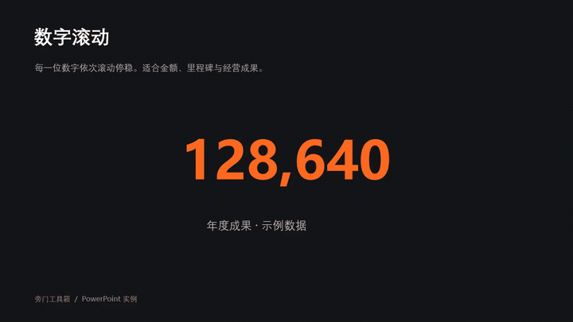
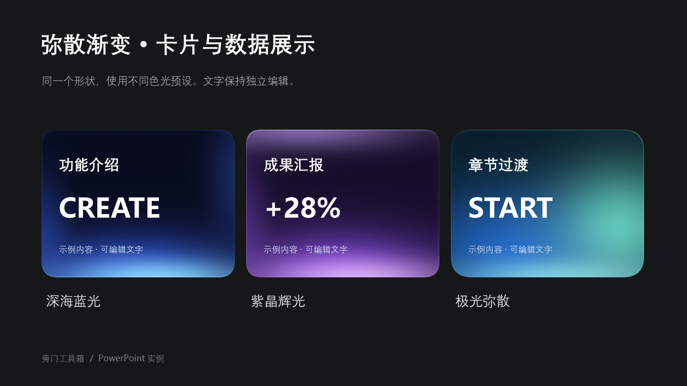
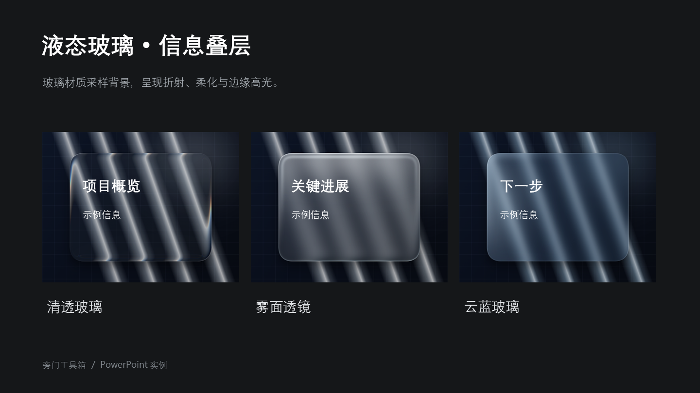

<p align="center"></p>
<h1 align="center">旁门工具箱</h1>
<p align="center"><strong>在 PowerPoint 里，为内容加上动画与材质。</strong></p>
<p align="center">形状效果 · 元素与文本动画 · 图片型 PDF 导出</p>
<p align="center">
<a href="https://github.com/sxx297/pangmen-toolbox/releases/latest"><strong>下载安装包</strong></a> ·
<a href="https://github.com/sxx297/pangmen-toolbox/releases/download/v1.0.11/pangmen-toolbox-examples.pptx">下载示例 PPT</a> ·
<a href="docs/USER_GUIDE.md">使用指南</a> ·
<a href="https://github.com/sxx297/pangmen-toolbox/issues">反馈问题</a>
</p>
<p align="center"><sub>Windows 桌面版 PowerPoint · v1.0.11 · GPL-3.0-only 开源</sub></p>

---

> **下载状态：** 安装包与示例 PPT 正在发布准备中，下载链接暂未开放。源码与下方案例可先查看。

## 先看效果

### 轰然坠落

快速坠落、短促震动，落点尘雾向两侧扩散。适合产品登场、章节标题和需要强调的重点内容。

<p align="center"></p>

**怎么做：** 选中对象 → 动画库 → 元素动画 / 进入 → 轰然坠落。可调整时长、动作幅度与尘雾开关。本例时长 **1.8 秒**。

### 数字滚动

每一位数字上下滚动、依次停稳，用于金额、里程碑、增长指标和成果汇报。直接读取选中的数字文本框，保留数值格式。

<p align="center"></p>

**怎么做：** 选中单个数字文本框 → 文本动画 / 进入 → 数值滚动。本例使用 **128,640**，时长 **2.4 秒**，数据仅作演示。

> 上述动图由插件原生执行逻辑生成，再由 Microsoft PowerPoint 导出视频、转换为 GIF，未用浏览器动画替代。GIF 为循环展示；示例 PPT 中是单次进入动画。

### 弥散渐变：给卡片和数据页增加层次

从深海蓝光、紫晶辉光到极光弥散，选择预设后还可调整色光的位置、颜色、强度、模糊与混合模式。

<p align="center"></p>

**适用场景：** 功能介绍卡片、关键指标、产品介绍和章节过渡。示例文字为独立 PowerPoint 文本，可继续编辑。

### 液态玻璃：让信息浮在背景之上

清透玻璃突出折射与边缘高光；雾面透镜柔化背景；云蓝玻璃提供更含蓄的颜色与层次。

<p align="center"></p>

**适用场景：** 信息浮层、项目概览、图片上的说明与封面信息区。玻璃效果依赖背景，背景变化后可点击“刷新背景”重新生成。

<sub>形状案例使用插件实际材质渲染器生成，再放入 PowerPoint 排版并导出；展示图为幻灯片输出，不是桌面界面截图。示例 PPT 中的材质为渲染图像，文字保持独立编辑。</sub>

## 能做什么

| 模块 | 主要能力 | 常见用途 |
| --- | --- | --- |
| **动画库** | 38 款元素动画 + 13 款文本动画；进入、强调、循环、退出；预览与参数调整 | 产品登场、标题节奏、数据展示、重点强调 |
| **形状效果** | 弥散渐变、液态玻璃、多层色光、预设保存、导出 PNG、恢复原样 | 卡片、封面、信息叠层、装饰形状 |
| **PDF 导出** | 选择页面与输出质量，输出图片型 PDF | 固定版式交付、分享演示内容 |
| **面板布局** | 侧栏与悬浮窗；统一控件、图层操作与提示 | 边做边调，按屏幕空间选择布局 |

数量依据 **v1.0.11 正式开放目录**，不包含待实现和已移除效果。[查看完整动画清单与参数说明 →](docs/USER_GUIDE.md#动画库)

<details>
<summary><strong>展开查看编辑器界面</strong></summary>

以下为同源页面的独立预览界面，便于了解布局；上方案例展示的是 PowerPoint 导出效果。

<p align="center"></p>
<p align="center"></p>

</details>

## 安装与上手

### 1. 下载并安装

从 [最新 Release](https://github.com/sxx297/pangmen-toolbox/releases/latest) 下载 **PangmenToolbox-1.0.11-Windows.zip**，解压后运行其中的安装程序。压缩包包含安装器、许可证、第三方声明与安装说明；Release 同时提供独立 EXE 和 SHA256 校验文件。

1. 保存文稿并关闭 PowerPoint。
2. 运行 `PangmenToolbox-Setup-1.0.11.exe`，按提示安装。
3. 重新打开 PowerPoint，在“旁门工具箱”选项卡启动功能。

**环境要求：** Windows 桌面版 Microsoft PowerPoint、.NET Framework 4.8、Microsoft Edge WebView2 Runtime。安装器自动检测 Office 位数；当前主要实测环境为 **64 位 Office**。

### 2. 打开示例，直接试用

[下载四页示例 PPT](https://github.com/sxx297/pangmen-toolbox/releases/download/v1.0.11/pangmen-toolbox-examples.pptx)：包含轰然坠落、数字滚动、弥散渐变、液态玻璃。前两页可直接放映；后两页展示材质组合与可编辑文字。示例用途和生成方法见 [案例说明](examples/README.md)。

### 3. 应用到自己的内容

- **动画：** 选中对象，选择卡片，调整有效参数；按需要选择“替换动画 / 保留动画”和“单击时 / 同时开始 / 之后开始”。使用底栏按钮在 PowerPoint 中预览，修改后可更新。
- **形状：** 选中支持的形状，打开形状效果，选择预设并微调，点击“应用到选中形状”。想撤回材质时使用“恢复原样”。
- **导出：** 打开 PDF 导出，选择页面和质量，然后保存输出。

完整步骤、数字动画限制与常见问题见 [使用指南](docs/USER_GUIDE.md)。

## 使用前了解

- **数字动画**：一个文本框内只包含一个数值；绝对值不超过 **999,999,999**，小数最多 **6 位**，符号与单位合计最多 **40 个字符**。还需满足单行、统一字体格式、字号不超过 180 磅、无旋转/填充/边框等条件。
- **材质效果**：使用渲染图像表现，不是 PowerPoint 原生的实时玻璃着色器；部分旋转、翻转、组合及导入对象受限制。
- **PDF**：为图片型输出，文字不可搜索或作为文本选择。
- **兼容性**：不支持 macOS、网页版 PowerPoint；未验证所有历史 Office 版本及 32 位 Office 功能组合。
- **签名状态**：安装包当前没有发布者 Authenticode 签名。不要为安装关闭系统防护或绕过组织策略。

遇到安装问题，可使用开始菜单的修复/诊断入口。[反馈问题](https://github.com/sxx297/pangmen-toolbox/issues) 时注明版本、系统及 Office 位数，公开诊断前删除个人路径和客户信息。

## 开发与贡献

在 Windows 中准备 Python 3.10+、Node.js 20+ 与 Windows PowerShell 5.1：

```powershell
npm ci
python tools/bootstrap-build.py
python tools/build-toolbox.py
```

输出位于 `dist/`。源码构建会生成独立开发强名称密钥，正式私钥不随仓库发布。请在测试环境验证自行构建的安装包。

<details>
<summary>浏览器预览与目录结构</summary>

```powershell
python tools/build-theme.py
python features/shapes/prototype/build-preview.py
python features/animations/build-preview.py
python tools/preview.py
```

打开 <http://127.0.0.1:8780>，使用示例内容，不读写 PPT。

| 目录 | 内容 |
| --- | --- |
| `host/` | COM 加载项、Ribbon、任务面板、窗口管理 |
| `features/` | 形状、动画、PDF 功能实现 |
| `shared/ui/` | 公共主题与组件 |
| `installer/` | 安装、修复、卸载、诊断 |
| `tools/`、`tests/` | 构建与回归检查 |
| `examples/` | 展示案例生成脚本与说明 |

</details>

[构建说明](docs/BUILDING.md) · [贡献指南](CONTRIBUTING.md) · [安全说明](SECURITY.md)

## 开源许可

本项目原创代码按 **GPL-3.0-only** 发布，参见 [LICENSE](LICENSE)。第三方部分保留原许可，见 [第三方声明](THIRD_PARTY_NOTICES.md)。
