# 效果画廊

[返回首页](../README.md)

## 动画画廊

**51 款正式动画 · 38 款元素动画 + 13 款文本动画**

展开分类查看全部动图，点击缩略图可放大。所有动画均由插件原生逻辑在真实 PowerPoint 中执行、导出，案例字体为思源黑体。

GIF 循环仅用于展示；进入、强调和退出效果保留短暂停顿，循环效果展示一个周期。实际效果仍由 PPT 中的播放设置控制。

### 元素动画

<strong>进入 · 16 款</strong>

<table>
<tr>
<td width="33%" align="center"><a href="media/gallery/alternate-in.gif">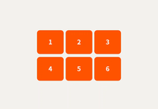</a> <strong>交错入场</strong></td>
<td width="33%" align="center"><a href="media/gallery/pivot-in.gif">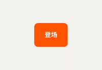</a> <strong>绕轴旋入</strong></td>
<td width="33%" align="center"><a href="media/gallery/jack-in.gif">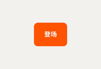</a> <strong>俏皮弹入</strong></td>
</tr>
<tr>
<td width="33%" align="center"> <strong>滚动进入</strong></td>
<td width="33%" align="center"><a href="media/gallery/grid-in.gif">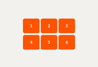</a> <strong>错峰进入</strong></td>
<td width="33%" align="center"><a href="media/gallery/anvil.gif">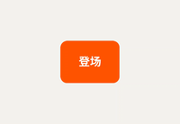</a> <strong>轰然坠落</strong></td>
</tr>
<tr>
<td width="33%" align="center"><a href="media/gallery/spring.gif">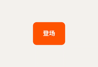</a> <strong>弹性弹入</strong></td>
<td width="33%" align="center"><a href="media/gallery/float-in.gif">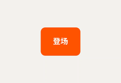</a> <strong>柔和上浮</strong></td>
<td width="33%" align="center"><a href="media/gallery/bounce-in.gif">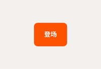</a> <strong>弹跳落地</strong></td>
</tr>
<tr>
<td width="33%" align="center"><a href="media/gallery/brake-in.gif">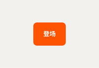</a> <strong>滑行刹停</strong></td>
<td width="33%" align="center"><a href="media/gallery/zoom-in.gif">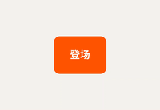</a> <strong>缩放登场</strong></td>
<td width="33%" align="center"><a href="media/gallery/impact-in.gif">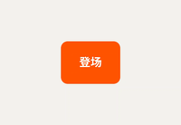</a> <strong>放大冲入</strong></td>
</tr>
<tr>
<td width="33%" align="center"><a href="media/gallery/flip-in.gif">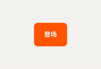</a> <strong>翻转入场</strong></td>
<td width="33%" align="center"><a href="media/gallery/rotate-in.gif">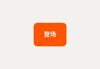</a> <strong>旋转落位</strong></td>
<td width="33%" align="center"><a href="media/gallery/fold-in.gif">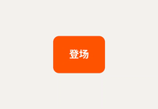</a> <strong>折叠展开</strong></td>
</tr>
<tr>
<td width="33%" align="center"> <strong>柔和淡入</strong></td>
<td width="33%"></td>
<td width="33%"></td>
</tr>
</table>

<strong>强调 · 6 款</strong>

<table>
<tr>
<td width="33%" align="center"><a href="media/gallery/flip-once.gif">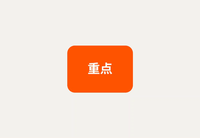</a> <strong>翻转一次</strong></td>
<td width="33%" align="center"> <strong>轻弹一下</strong></td>
<td width="33%" align="center"><a href="media/gallery/jelly.gif">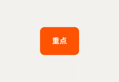</a> <strong>果冻弹动</strong></td>
</tr>
<tr>
<td width="33%" align="center"> <strong>摇摆提示</strong></td>
<td width="33%" align="center"><a href="media/gallery/shake.gif">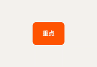</a> <strong>震动提醒</strong></td>
<td width="33%" align="center"> <strong>聚焦放大</strong></td>
</tr>
</table>

<strong>循环 · 6 款</strong>

<table>
<tr>
<td width="33%" align="center"><a href="media/gallery/orbit.gif">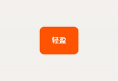</a> <strong>轨道浮游</strong></td>
<td width="33%" align="center"><a href="media/gallery/hover.gif">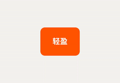</a> <strong>轻盈悬浮</strong></td>
<td width="33%" align="center"> <strong>呼吸缩放</strong></td>
</tr>
<tr>
<td width="33%" align="center"><a href="media/gallery/pendulum.gif">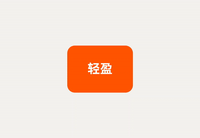</a> <strong>往返摇动</strong></td>
<td width="33%" align="center"><a href="media/gallery/spin.gif">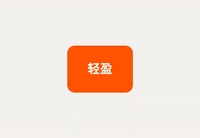</a> <strong>匀速旋转</strong></td>
<td width="33%" align="center"><a href="media/gallery/heartbeat.gif">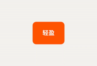</a> <strong>心跳脉冲</strong></td>
</tr>
</table>

<strong>退出 · 10 款</strong>

<table>
<tr>
<td width="33%" align="center"> <strong>绕轴旋出</strong></td>
<td width="33%" align="center"><a href="media/gallery/roll-out.gif">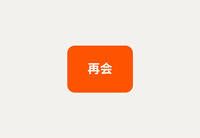</a> <strong>滚动退出</strong></td>
<td width="33%" align="center"><a href="media/gallery/grid-out.gif">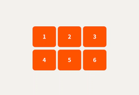</a> <strong>错峰退出</strong></td>
</tr>
<tr>
<td width="33%" align="center"> <strong>柔和淡出</strong></td>
<td width="33%" align="center"> <strong>滑动离场</strong></td>
<td width="33%" align="center"> <strong>回缩消失</strong></td>
</tr>
<tr>
<td width="33%" align="center"> <strong>弹射离场</strong></td>
<td width="33%" align="center"> <strong>旋转收走</strong></td>
<td width="33%" align="center"> <strong>坠落离场</strong></td>
</tr>
<tr>
<td width="33%" align="center"> <strong>折叠退场</strong></td>
<td width="33%"></td>
<td width="33%"></td>
</tr>
</table>

### 文本动画

<strong>进入 · 7 款</strong>

<table>
<tr>
<td width="33%" align="center"> <strong>数值变动</strong></td>
<td width="33%" align="center"><a href="media/gallery/number-roll.gif">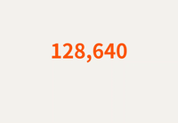</a> <strong>数值滚动</strong></td>
<td width="33%" align="center"> <strong>逐字出现</strong></td>
</tr>
<tr>
<td width="33%" align="center"> <strong>逐字弹入</strong></td>
<td width="33%" align="center"> <strong>逐字上浮</strong></td>
<td width="33%" align="center"> <strong>字符翻入</strong></td>
</tr>
<tr>
<td width="33%" align="center"> <strong>字距收拢</strong></td>
<td width="33%"></td>
<td width="33%"></td>
</tr>
</table>

<strong>强调 · 2 款</strong>

<table>
<tr>
<td width="33%" align="center"> <strong>逐字强调波</strong></td>
<td width="33%" align="center"> <strong>荧光标记</strong></td>
<td width="33%"></td>
</tr>
</table>

<strong>循环 · 1 款</strong>

<table>
<tr>
<td width="33%" align="center"> <strong>呼吸文字</strong></td>
<td width="33%"></td>
<td width="33%"></td>
</tr>
</table>

<strong>退出 · 3 款</strong>

<table>
<tr>
<td width="33%" align="center"> <strong>逐字淡出</strong></td>
<td width="33%" align="center"> <strong>逐字下沉</strong></td>
<td width="33%" align="center"> <strong>向外飞散</strong></td>
</tr>
</table>

## 形状画廊

**28 个内置预设 · 16 个弥散渐变 + 12 个液态玻璃**

以下图片使用插件实际材质渲染器生成。玻璃统一使用预设库内置的绸缎背景，便于比较折射、模糊与边缘高光。光球、透镜保留圆形轮廓，其他预设使用圆角矩形。

### 弥散渐变

<table>
<tr>
<td width="33%" align="center"> <strong>冰蓝弥散</strong></td>
<td width="33%" align="center"> <strong>紫色辉光</strong></td>
<td width="33%" align="center"><a href="media/gallery/material-aurora.png">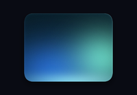</a> <strong>极光混色</strong></td>
</tr>
<tr>
<td width="33%" align="center"><a href="media/gallery/material-amber.png">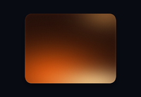</a> <strong>琥珀暖光</strong></td>
<td width="33%" align="center"><a href="media/gallery/material-rose.png">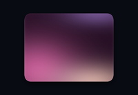</a> <strong>玫瑰霞光</strong></td>
<td width="33%" align="center"><a href="media/gallery/material-jade.png">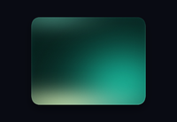</a> <strong>翡翠流光</strong></td>
</tr>
<tr>
<td width="33%" align="center"><a href="media/gallery/material-violetOrb.png">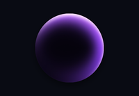</a> <strong>紫晶光球</strong></td>
<td width="33%" align="center"><a href="media/gallery/material-azureOrb.png">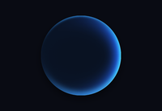</a> <strong>冰蓝光球</strong></td>
<td width="33%" align="center"><a href="media/gallery/material-spectrumFrame.png">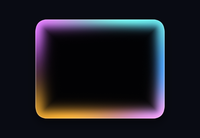</a> <strong>幻彩霓虹</strong></td>
</tr>
<tr>
<td width="33%" align="center"><a href="media/gallery/material-violetFrame.png">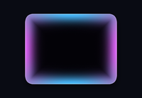</a> <strong>蓝紫光框</strong></td>
<td width="33%" align="center"> <strong>青瓷微光</strong></td>
<td width="33%" align="center"> <strong>极光顶光</strong></td>
</tr>
<tr>
<td width="33%" align="center"> <strong>鎏金磨砂</strong></td>
<td width="33%" align="center"><a href="media/gallery/material-silver.png">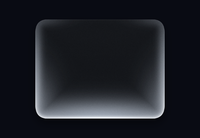</a> <strong>冷银磨砂</strong></td>
<td width="33%" align="center"><a href="media/gallery/material-roseCopper.png">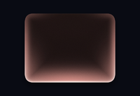</a> <strong>玫瑰铜光</strong></td>
</tr>
<tr>
<td width="33%" align="center"> <strong>赤铜暖光</strong></td>
<td width="33%"></td>
<td width="33%"></td>
</tr>
</table>

### 液态玻璃

<table>
<tr>
<td width="33%" align="center"><a href="media/gallery/material-glass.png">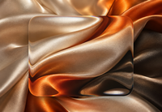</a> <strong>通透玻璃</strong></td>
<td width="33%" align="center"><a href="media/gallery/material-frosted.png">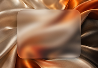</a> <strong>柔雾玻璃</strong></td>
<td width="33%" align="center"><a href="media/gallery/material-smoked.png">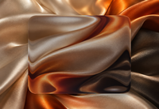</a> <strong>深色玻璃</strong></td>
</tr>
<tr>
<td width="33%" align="center"><a href="media/gallery/material-champagne.png">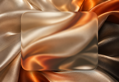</a> <strong>香槟玻璃</strong></td>
<td width="33%" align="center"><a href="media/gallery/material-ice.png">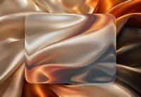</a> <strong>冰蓝玻璃</strong></td>
<td width="33%" align="center"><a href="media/gallery/material-pearl.png">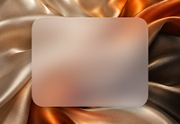</a> <strong>珍珠柔雾</strong></td>
</tr>
<tr>
<td width="33%" align="center"> <strong>水晶透镜</strong></td>
<td width="33%" align="center"><a href="media/gallery/material-mistLens.png">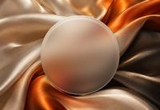</a> <strong>雾面透镜</strong></td>
<td width="33%" align="center"><a href="media/gallery/material-sandPane.png">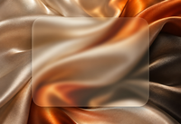</a> <strong>暖砂薄玻璃</strong></td>
</tr>
<tr>
<td width="33%" align="center"><a href="media/gallery/material-cloudPane.png">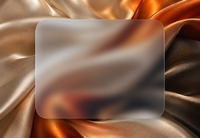</a> <strong>云蓝玻璃</strong></td>
<td width="33%" align="center"><a href="media/gallery/material-milkPane.png">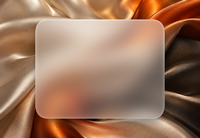</a> <strong>乳白磨砂</strong></td>
<td width="33%" align="center"><a href="media/gallery/material-midnightPane.png">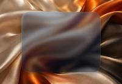</a> <strong>深蓝柔光玻璃</strong></td>
</tr>
</table>
